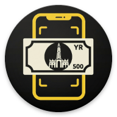

<div align="center">
  
  <h1>بقش | Bigash</h1>
  <p><strong>تعرّف على فئات العملة الورقية اليمنية بالصوت والاهتزاز</strong></p>
  <p>📷 كاميرا الهاتف&nbsp;&nbsp;•&nbsp;&nbsp;🧠 ذكاء اصطناعي محلي&nbsp;&nbsp;•&nbsp;&nbsp;🔊 نطق عربي&nbsp;&nbsp;•&nbsp;&nbsp;📳 إشارات لمسية</p>
</div>

> [!NOTE]
> **بقش** تطبيق مساعد للمكفوفين وضعاف البصر، يعمل محليًا على الهاتف دون حفظ صور الكاميرا أو رفعها إلى الإنترنت.

## 🎯 فكرة التطبيق

يستخدم **بقش** كاميرا الهاتف ونموذج ذكاء اصطناعي بصيغة TensorFlow Lite
للتعرّف على فئة الورقة النقدية اليمنية. صُممت الواجهة لمن لا يعتمد على النظر؛
فكامل الشاشة مساحة لمس واحدة، والنتيجة تصل إلى المستخدم بالنطق العربي
والاهتزاز.

| 🔎 لمحة سريعة | التفاصيل |
|:---|:---|
| 👥 المستفيدون | المكفوفون وضعاف البصر |
| 💴 المهمة | التعرّف على فئات الريال اليمني الورقية |
| 🗣️ النتيجة | إعلان صوتي عربي مع اهتزاز تأكيدي |
| 🌐 الاتصال | لا يحتاج إلى الإنترنت أثناء التعرّف |
| 🔒 الخصوصية | المعالجة على الجهاز ولا يتم حفظ الصور |
| 📱 التفاعل | ضغطة واحدة في أي مكان لبدء المسح أو إيقافه |

## 🔄 كيف يعمل؟

```text
📷 التقاط إطار
      ↓
🔍 فحص الإضاءة والوضوح
      ↓
🧠 تحليل محلي بنموذج TFLite
      ↓
✅ تأكيد النتيجة عبر عدة إطارات
      ↓
🔊 نطق الفئة  +  📳 اهتزاز تأكيدي
```

لا يعلن التطبيق أول تخمين يظهر له؛ بل يفحص جودة الصورة ومستوى الثقة، ثم يجمع
نتائج عدة إطارات لتقليل احتمالية نطق فئة خاطئة.

## ✨ أبرز المزايا

- ♿ **مصمم للوصول:** تعليمات صوتية عربية، دعم قارئ الشاشة، وعناصر لمس كبيرة.
- 📴 **يعمل دون إنترنت:** النموذج مضمّن داخل التطبيق ويعمل على الجهاز.
- 🛡️ **يحافظ على الخصوصية:** لا يحفظ صور العملة ولا يرسلها إلى خادم خارجي.
- 🎯 **يتحقق قبل الإعلان:** يستخدم بوابات للثقة وتصويتًا بين عدة إطارات.
- 🔦 **يتعامل مع الإضاءة:** يشغّل ضوء الكاميرا عند الحاجة إذا كان متاحًا.
- 🗣️ **يرشد المستخدم:** يطلب تثبيت الهاتف أو تغيير المسافة عندما تكون الصورة غير مناسبة.
- 📳 **يوفر قناة بديلة:** الاهتزاز يؤكد حالة المسح والنتيجة حتى عند تعذر الصوت.
- ⏸️ **سهل التحكم:** ضغطة واحدة في أي مكان تبدأ المسح أو توقفه.

## 💴 الفئات المدعومة

| 💵 الفئة | 🖼️ التصاميم التي يميزها النموذج |
|---:|:---|
| 50 ريالًا | تصميم واحد |
| 100 ريال | التصميم القديم والجديد |
| 200 ريال | التصميم القديم والجديد |
| 250 ريالًا | تصميم واحد |
| 500 ريال | تصميم واحد |
| 1000 ريال | تصميم واحد |

يحتوي النموذج كذلك على فئة **«أخرى»** للأجسام والصور التي لا تمثل عملة يمنية،
حتى لا يحاول تحويل كل ما تراه الكاميرا إلى فئة نقدية.

## 📱 طريقة الاستخدام

1. 🔊 **جهّز الصوت:** تأكد من تثبيت صوت عربي للنطق على الهاتف.
2. 🔐 **اسمح بالكاميرا:** افتح التطبيق وامنحه إذن استخدام الكاميرا.
3. 👆 **ابدأ المسح:** اضغط في أي مكان على شاشة الماسح.
4. 📷 **وجّه الهاتف:** ضع الورقة أمام الكاميرا الخلفية وحرّكها ببطء.
5. 🗣️ **اتبع الإرشادات:** ثبّت الهاتف أو غيّر المسافة إذا طلب التطبيق ذلك.
6. ✅ **انتظر التأكيد:** سيعلن التطبيق الفئة ويصدر اهتزازًا عند نجاح التعرّف.
7. ⏹️ **أوقف المسح:** اضغط على الشاشة مرة أخرى.

## 🚦 دلالات الواجهة

الألوان دعم إضافي للمستخدم المبصر جزئيًا، بينما يظل الصوت والاهتزاز وسيلتي
الاستخدام الأساسيتين.

| الإشارة | الحالة | ما الذي ينبغي فعله؟ |
|:---:|:---|:---|
| 🟠 برتقالي | المسح جارٍ | وجّه الكاميرا نحو العملة وانتظر |
| 🔴 أحمر | الصورة غير مناسبة | حسّن الإضاءة أو ثبّت الهاتف أو غيّر المسافة |
| 🟢 أخضر | تم التعرّف | استمع إلى الفئة المعلنة |
| 📳 نبضات قصيرة | التطبيق يحلل الصورة | استمر في توجيه الكاميرا |
| 📳 اهتزاز تأكيدي | ظهرت نتيجة | استمع إلى الإعلان الصوتي |

## 🔐 الخصوصية والأذونات

تُعالج إطارات الكاميرا داخل ذاكرة الهاتف بواسطة النموذج المضمّن. التطبيق:

- ✅ يستخدم الكاميرا فقط لالتقاط إطارات التعرّف.
- ✅ يستخدم الاهتزاز لتقديم إشارات لمسية.
- ❌ لا يسجل الصوت.
- ❌ لا يقرأ ملفات الهاتف.
- ❌ لا يحفظ صور الكاميرا.
- ❌ لا يرفع الصور إلى الإنترنت.

> [!IMPORTANT]
> قد يحتاج المستخدم إلى تنزيل صوت عربي من إعدادات نظام التشغيل مرة واحدة إذا لم يكن مثبتًا. بعد ذلك لا تحتاج عملية التعرّف نفسها إلى اتصال بالشبكة.

## 🧰 التقنيات المستخدمة

| التقنية | دورها في المشروع |
|:---|:---|
| Flutter وDart | بناء واجهة التطبيق وتشغيله على الهاتف |
| Camera | قراءة إطارات الكاميرا الخلفية |
| TensorFlow Lite | تشغيل نموذج التعرّف محليًا |
| Flutter TTS | نطق الفئة والتعليمات بالعربية |
| Vibration | تقديم الإشارات اللمسية |
| flutter_bloc | إدارة حالات المسح والتعرّف |
| get_it | حقن الاعتماديات وربط طبقات المشروع |

## 🚀 تشغيل المشروع

### 📋 المتطلبات

- Flutter 3.32 أو أحدث.
- Dart 3.8 أو أحدث.
- Android SDK.
- جهاز أو محاكي مزود بكاميرا.
- يفضّل استخدام جهاز حقيقي لاختبار الكاميرا والاهتزاز والنطق العربي.

### ▶️ التنزيل والتشغيل

```bash
git clone https://github.com/JaafarAbdulkareem/bigash.git
cd bigash
flutter pub get
flutter run
```

### 🧪 الفحص والاختبارات

```bash
flutter analyze
flutter test
```

### 📦 بناء ملف APK

```bash
flutter build apk --release
```

> [!WARNING]
> تستخدم نسخة Release المحلية مفتاح debug إذا لم يوجد `android/key.properties`. قبل النشر، أعدّ مفتاح توقيع حقيقي وغيّر معرّف الحزمة `com.example.bigash` إلى معرّف فريد تملكه.

## 🏗️ بنية المشروع

```text
bigash/
├── lib/
│   ├── core/           # حقن الاعتماديات والأجزاء المشتركة
│   ├── data/           # الكاميرا وTFLite وتحويل الإطارات والنطق
│   ├── domain/         # الجودة والثقة والتصويت وتوحيد التسميات
│   └── presentation/   # الشاشات والواجهات وإدارة حالة التعرّف
├── assets/             # نموذج الذكاء الاصطناعي وملف التسميات
├── test/               # اختبارات المنطق والخدمات والواجهة
└── tools/              # تدريب النموذج وتقييمه وتجهيز البيانات
```

يتبع المشروع أسلوب **Clean Architecture**:

1. 🖼️ **Presentation:** تعرض حالة الماسح وتستقبل ضغطة المستخدم.
2. 📐 **Domain:** تحتوي قواعد القرار والجودة والتصويت دون الاعتماد على الواجهة.
3. ⚙️ **Data:** تتعامل مع الكاميرا والنموذج والنطق والخدمات الفعلية.

## 🤖 عقد نموذج التعرّف

يعمل التطبيق باستخدام ملفين يجب أن يأتيا من عملية التدريب نفسها:

- `assets/bigash_v18.tflite` — نموذج التعرّف.
- `assets/labels.txt` — ترتيب الفئات المطابق لمخارج النموذج.

يتوقع النموذج الحالي:

- 🖼️ صورًا مربعة بحجم **224×224**.
- 🎚️ قيم بكسل خام ضمن `[0,255]`.
- 📑 ترتيب تسميات مطابقًا لترتيب مخارج النموذج.
- 🔏 بصمة SHA-256 مطابقة للنموذج الذي تمت مراجعته.

> [!CAUTION]
> تغيير التطبيع أو القص أو ترتيب التسميات دون نموذج متوافق قد يؤدي إلى إعلان فئة خاطئة. لهذا يرفض التطبيق تشغيل النموذج عند اكتشاف عدم التطابق.

عند اعتماد نموذج جديد بعد تقييمه، حدّث `expectedBigashModelSha256` داخل
`lib/domain/currency/model_asset_contract.dart` ضمن التغيير نفسه.

## ✅ قائمة التحقق قبل النشر

- [ ] تشغيل `flutter analyze` دون أخطاء.
- [ ] نجاح جميع اختبارات `flutter test`.
- [ ] بناء التطبيق باستخدام `flutter build apk --release`.
- [ ] تجربة ملف APK على جهاز حقيقي.
- [ ] اختبار جميع الفئات اليمنية المدعومة.
- [ ] الاختبار بإضاءات وخلفيات ومسافات ودرجات اهتراء مختلفة.
- [ ] تجربة عملات أجنبية وأشياء غير نقدية والتأكد من عدم إعلانها كفئة يمنية.
- [ ] إعداد مفتاح توقيع حقيقي ومعرّف حزمة مملوك قبل النشر.

للمزيد، راجع [📄 تقرير الفحص الأمني والتشغيلي](FORENSIC_AUDIT.md).

## ⚠️ حدود الاستخدام

تتأثر نماذج الرؤية بجودة الكاميرا والإضاءة وحالة الورقة النقدية. **بقش أداة
مساعدة**؛ لذلك يُنصح بالتحقق بطريقة إضافية في المعاملات الحساسة أو عندما تكون
الورقة ممزقة أو مطموسة بشدة.
